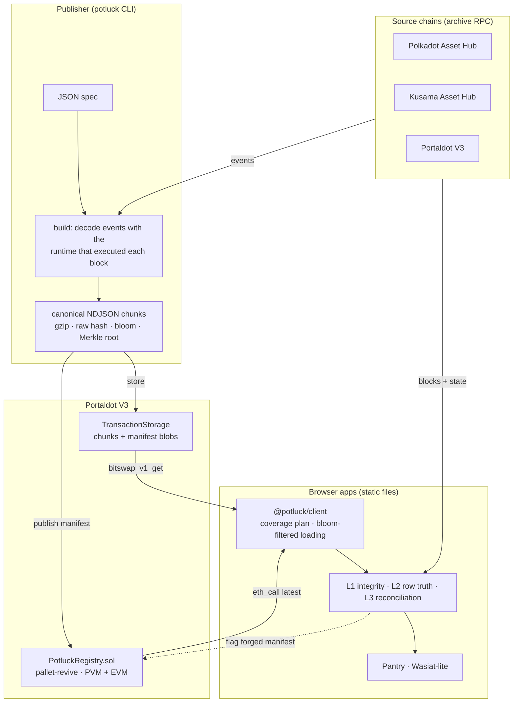

# Potluck

> **Everyone brings a chunk. Every dApp gets the history.**

On-chain history for any dApp, loaded in the browser with no servers, stored and guaranteed by [Portaldot](https://portaldot-dev.readthedocs.io/), and verified against the chain it came from.

**Live:** [Landing page](https://wngstnr-code.github.io/potluck/) · [Pantry](https://wngstnr-code.github.io/potluck/pantry/) · [Wasiat-lite](https://wngstnr-code.github.io/potluck/wasiat/) (static files on GitHub Pages; every number is read from the chains in your browser).

Built for **Portaldot Hacker House 2026** (track: Modular Cloud & Middleware). Solo project by [@wngstnr-code](https://github.com/wngstnr-code).

## The problem
RPC nodes answer "what is the state now", but dApps need history: transfers, holders, who inherited what, and when.
- Today every dApp runs or rents an indexer server.
- Users have to trust that server's database.
- When the server goes away, the history goes with it.

## The idea
- **Publishers** run a declarative JSON spec against a source chain (Polkadot Asset Hub, Kusama Asset Hub, or Portaldot itself).
  - They store compact, canonical index chunks in **Portaldot's TransactionStorage**, where validators must keep proving they hold the data.
  - They register a manifest in **`PotluckRegistry.sol` on Portaldot's pallet-revive** (one Solidity source, deployed to both PVM and EVM).
- **Browsers** fetch only the chunks they need through the node's `bitswap_v1_get`. Then they **verify them against the source chain**, not against the publisher:

  | Level | Check | Catches |
  |---|---|---|
  | L1 · Integrity | digest, raw hash, canonical encoding, bloom | corrupted or swapped chunks |
  | L2 · Row truth | each row re-derived from its block's events | invented or altered rows |
  | L3 · Reconciliation | balance before + every row's effect = balance after, for every account and window | **hidden rows**, even when every hash was forged |

- **Adaptive sync.** When direct sync is cheap (Portaldot today: ~2.5 min from genesis in a browser), the SDK syncs directly. When it is not (Polkadot Asset Hub: days of RPC calls), it uses verified snapshots. A lying publisher is caught, flagged on chain, and skipped.

## Architecture



## What runs today (measured)

| Component | Result |
|---|---|
| Portaldot V3 unified history (native + EVM/PVM tokens), CLI | 116,549 blocks → 2,176 rows in 158 s; `verify --rebuild` reconciles 899 / 899 accounts |
| Same history in the browser (Pantry) | 2,248 rows / 912 accounts loaded by direct sync in 2 min 25 s; 905 / 905 account checks reconciled in 22.7 s; live tail follows new blocks |
| Polkadot AH from its snapshot (Pantry) | Newest 80,000 Asset Hub blocks: 114,460 rows / 23,268 accounts loaded from Portaldot in **5.6–6.4 s**; direct sync measured in the same browser at 117 blocks/s ≈ 11 min 23 s (events only). One account: 147 / 147 rows re-derived (L2) and its balance reconciled exactly (L3) against Polkadot Asset Hub |
| Fetch a published chunk (bitswap) | 2.5 MB Polkadot AH chunk from the public Portaldot node in ≈ 4 s; indexing the same 80,000 blocks takes 316 s |
| Load from the registry (Pantry) | Portaldot history #1–#129,069 from its published snapshot + a direct-synced tail in **3.0 s** (1 min 9 s by direct sync); 938 / 938 account checks reconciled |
| Verify one account (Pantry) | 183 rows re-derived from 94 blocks (L2) + balance reconciled (L3) in 1.8 s |
| Attack demo (Pantry) | Forged chunk with every hash recomputed passes L1 and L2. L3 catches it (903 / 904) with the exact hidden amount as the difference |
| Inheritance plans (Wasiat-lite) | 121 plans, 14 open attempts, 13 inheritors on Kusama AH; every account's timeline replays to its current storage (133 / 133) |
| Runtime-version map (each block is decoded with the runtime that executed it) | built from `System.LastRuntimeUpgrade` reads in parallel: Portaldot genesis → head in 1.9 s (22 s before); live-tested on Polkadot AH's upgrade boundaries |

## Deployment (Portaldot V3 testnet)

| Item | Value |
|---|---|
| `PotluckRegistry` (EVM) | [`0xef9305561eb0c34d205dfa0d9099a105f44282eb`](https://node-console.portaldot.dev/#/explorer/query/129014), block #129,014, tx `0x3abb9058e1eb48628791a029de71ef11b510ebc7a5cfa81677425773ce0bc352` (deposit 433.2 tPOT) |
| Portaldot unified history | manifest 2: blocks #1–#129,069, 1 chunk; spec, chunk and manifest first stored in TransactionStorage at #129,092, #129,094 and #129,095, stored again after the 7-day retention at #236,974, #236,975 and #236,977 |
| `PotluckRegistry` (PVM) | [`0x528fc6d14a8b1cf4474d2999313f74533cf083b4`](https://node-console.portaldot.dev/#/explorer/query/236926), block #236,926, tx `0x5c4b897dd32d210b2370458c5ff21e90475643bd21d9e3dfe5258c4491b4d705` (resolc 1.4.0, 42,055 B; deposit 3,293.4 tPOT) |
| Polkadot AH balance history | manifest 3: newest 80,000 blocks (#22,021,128–#22,101,127), 114,460 rows in 2 chunks (3.2 MB), every account reconciled before publishing; chunks first stored at #129,230 and #129,232, stored again at #236,980 and #236,984 |
| Kusama AH recovery timeline | manifest 4: blocks #17,836,634–#22,802,789 (the Recovery inheritance API onward), 7 rows in 2 chunks (643 B); spec, chunks and manifest stored at #218,503–#218,507 |

Every address and hash is also in [`contracts/deployments/portaldot-v3-testnet.json`](contracts/deployments/portaldot-v3-testnet.json).

The contracts are tested (21 Foundry tests, 100% coverage) and both bytecodes pass `ReviveApi.instantiate` dry runs on the live testnet.

## Use Potluck in your dApp

`@potluck/client` runs in any browser bundle. One call gives an app verified history:

```ts
import { createPotluck } from "@potluck/client";

const potluck = await createPotluck(); // Portaldot V3 testnet preset: endpoints, registry, known specs

const spec = "polkadot-ah.balance-history"; // preset name, 0x spec hash, or a Spec object
const account = "15oF4uVJwmo4TdGW7VfQxNLavjCXviqxT9S1MgbjMNHr6Sp5"; // SS58, AccountId32 or H160

const history = await potluck.accountHistory({ spec, account });
history.rows;      // the account's rows, in block order
history.verified;  // L1 + L2 + L3 against the source chain
history.uncovered; // ranges neither published nor short enough to sync directly

// Live tail: new finalized rows for the same account
const stop = await potluck.follow({ spec, account, afterBlock: history.head, onRows: (rows) => {} });
```

- `potluck.specs()` lists every spec registered on chain, fetched from TransactionStorage and hash-checked, so an app needs no spec file of its own. Registration is permissionless, so spec names resolve only through the network preset; any other spec is used by its hash.
- `potluck.specHistory({ spec, onRows })` loads every row of a spec (Pantry's overview).
- Addresses are resolved through the chain's `ReviveApi`, so a Portaldot account matches both its native rows and its EVM/PVM token rows.
- The lower-level functions (`accountHistory`, `specHistory`, `followHistory`, `PortaldotSource`, `reconcileHistory`) stay exported for full control.

Published specs: `portaldot-v3-testnet.unified-history`, `polkadot-ah.balance-history` and `kusama-ah.recovery-timeline` (see `specs/`). To index something else, write a spec and publish it with the CLI below.

[`examples/minimal`](examples/minimal) is the whole integration in about 60 lines of plain TypeScript: `pnpm install && pnpm build && pnpm --filter @potluck/example-minimal dev`. The packages are not on npm yet; use them from this workspace.

## Run it

Requirements: Node ≥ 22, pnpm 10.

```bash
pnpm install && pnpm build

# Pantry: browse, load and verify histories in the browser
pnpm --filter @potluck/pantry dev        # http://localhost:5173

# Wasiat-lite: inheritance plans and verified timelines; set up a plan on Portaldot
pnpm --filter @potluck/wasiat dev        # next free port, e.g. http://localhost:5174

# Static builds (deploy the dist/ folders anywhere)
pnpm --filter @potluck/pantry build && pnpm --filter @potluck/wasiat build
```

### Publisher CLI

```bash
# Index a range into verifiable chunks (resumable). --last N for the newest N blocks.
node packages/cli/dist/index.js build specs/portaldot-v3-testnet.unified-history.json

# Check a build: integrity, independent re-index, and balance reconciliation against the chain
node packages/cli/dist/index.js verify builds/portaldot-v3-testnet.unified-history/<from>-<to> --rebuild

# Estimate publishing fees on Portaldot (no funds needed); drop --dry-run to publish
node packages/cli/dist/index.js publish builds/... --dry-run --from-address <ss58>

# Keep it current: index new blocks, verify, publish, renew what expires within a day
node packages/cli/dist/index.js sync specs/portaldot-v3-testnet.unified-history.json --registry <h160>

# Renew only (TransactionStorage keeps data ~7 days; a renewal costs ≈ 0.012 tPOT per blob)
node packages/cli/dist/index.js renew builds/... --registry <h160>

# Demo: forge a build that passes integrity checks, then watch verify catch it
node packages/cli/dist/index.js tamper builds/... --out /tmp/forged
node packages/cli/dist/index.js verify /tmp/forged --rebuild
```

### Tests

```bash
pnpm test                       # offline tests on recorded real chain data
POTLUCK_LIVE=1 pnpm test        # adds live tests against Polkadot AH, Kusama AH and Portaldot
pnpm test:contracts             # Foundry tests for PotluckRegistry
```

## Repository

| Path | What |
|---|---|
| `packages/spec` | Spec schema (zod), validation, canonical hash |
| `packages/core` | RPC, runtime-aware decoding, rows, chunks, manifests, L1/L2/L3 verification |
| `packages/client` | Browser SDK: snapshot + direct sync, account history, live tail, registry/bitswap source |
| `packages/cli` | Publisher CLI: build, verify, publish, renew, sync, tamper |
| `packages/theme`, `packages/ui` | Design tokens, fonts, shared React shell |
| `apps/pantry` | Catalog, overview, verify account, attack demo |
| `apps/wasiat` | Wasiat-lite: Recovery-pallet inheritance plans and timelines |
| `examples/minimal` | The smallest app on the SDK: spec discovery, verified account history, live tail |
| `contracts` | `PotluckRegistry.sol`, Foundry tests, PVM/EVM build and deploy scripts |
| `specs` | Portaldot unified history, Polkadot AH balance history, Kusama AH recovery timeline |
| `spikes` | Measurements behind the design (runtime decoding, fees, reconciliation, throughput) |

## Documentation
- [Concept](docs/POTLUCK.md)
- [Architecture, formats and decisions](docs/ARCHITECTURE.md)
- [Development status and plan](docs/DEVELOPMENT.md)
- [Design system](docs/DESIGN.md)
- [Documentation index](docs/README.md)

## Open-source dependencies
Polkadot.js (`@polkadot/api`, `types`, `util`, `extension-dapp`), viem, zod, React, Vite, TanStack Virtual, Foundry, resolc, IBM Plex (via Fontsource), Biome and Vitest. The landing page uses Next.js, Tailwind CSS, Motion, Headless UI and Radix Slot; the promo video is rendered with Remotion and three.js (React Three Fiber).

## License
MIT
